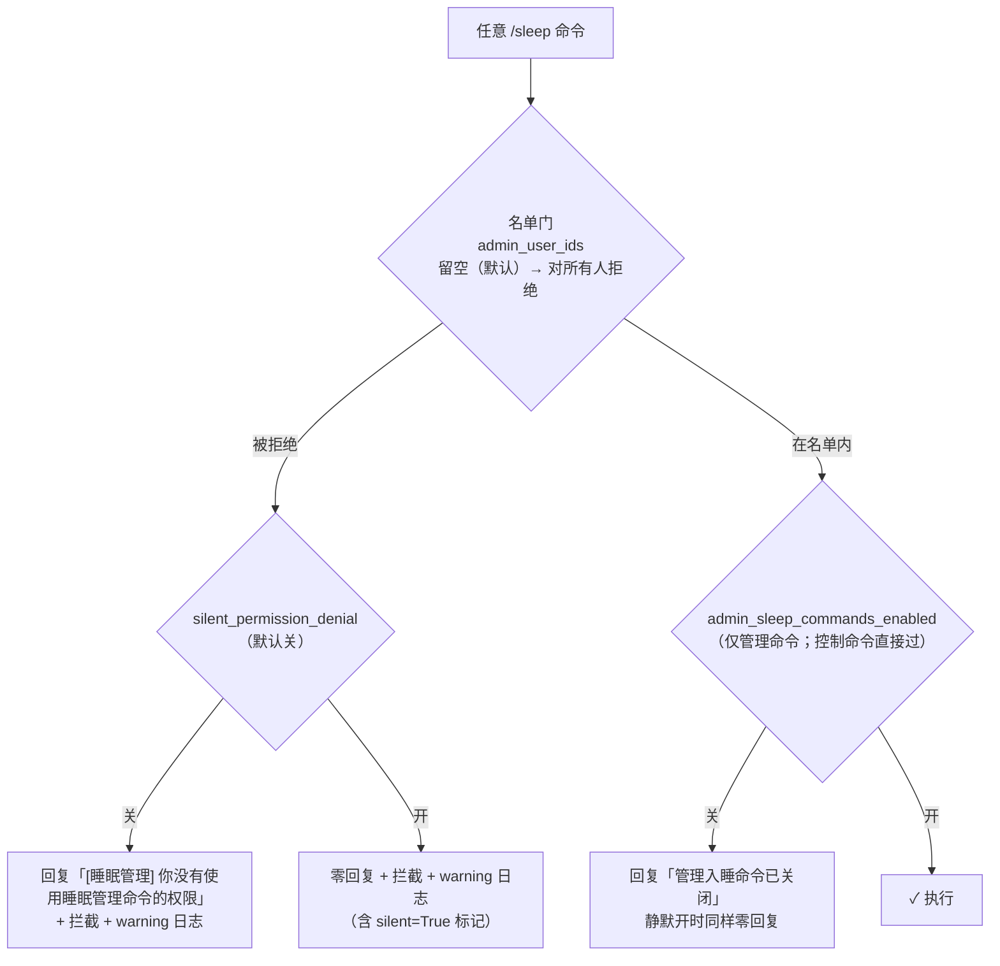

# 开发文档（commands）

> `/sleep` 命令参考与权限模型详设。架构背景见 [architecture.md](architecture.md)。

## 命令参考

| 组件 name（= 触发词） | pattern | 说明 | 权限层 |
| --- | --- | --- | --- |
| `sleep help` | `^/sleep help\s*$` | 查看全部命令帮助 | 名单门 |
| `sleep status` | `^/sleep status\s*$` | 查看当前作用域的睡眠状态 | 名单门 |
| `sleep wake` | `^/sleep wake\s*$` | 手动唤醒当前作用域 | 名单门 |
| `sleep wake_all` | `^/sleep wake_all\s*$` | 手动唤醒全部聊天流 | 名单门 |
| `sleep now` | `^/sleep now\s*$` | 窗口内记录管理员催睡，放行给 Planner | 名单门 + 管理开关 |
| `sleep forced` | `^/sleep forced\s*$` | 无视窗口立即入睡（当前作用域） | 名单门 + 管理开关 |
| `sleep forced_all` | `^/sleep forced_all\s*$` | 无视窗口让全部聊天流入睡 | 名单门 + 管理开关 |

- **组件 name 刻意与触发词一致**（含空格）：插件中心组件列表展示的 name 就是用户要敲的命令。宿主对 `@Command` name 无字符校验（匹配只靠 pattern），带空格已经探针验证无副作用。
- **pattern 整行锚定**：`^/sleep xxx\s*$`，多余前后缀不匹配。

## 权限模型

### 实现辅助（core/mixin.py）

- `_can_use_sleep_command(user_id)` — 名单门：名单去空后为空 → `False`；否则比对 `user_id.strip()`
- `_deny_command(stream_id, user_id, command_name)` — 拒绝处理：记 warning（命令名 + user + stream + silent 标记），按静默开关回复统一提示或返回 `(True, "", True)` 零回复
- `_check_command_permission(stream_id, user_id, command_name)` — 仅管理命令用：先查 `admin_sleep_commands_enabled` 开关（关 → 「已关闭」提示或静默），再过名单门。返回 `None` = 通过；返回字符串 = 已处理的拒绝消息（调用方作为三元组 response 返回）

### 配置字段关系

| 字段 | 默认 | 作用 |
| --- | --- | --- |
| `admin_user_ids` | `[]` | 全部命令的名单门；留空 = 所有命令对所有人不可用（默认安全） |
| `silent_permission_denial` | `false` | 被拒时零回复（只拦截 + 日志）；同时作用于「已关闭」提示 |
| `admin_sleep_commands_enabled` | `true` | 管理命令的存在性开关（第二层）；与名单是两层，关了即使有权限也提示已关闭 |
| `control_commands_enabled` | `true` | 只控制睡眠期入站拦截是否放行命令文本，**不做权限过滤**（非睡眠期没有入站拦截层，权限只能放命令层一处生效） |

### 行为语义要点

- **静默 = 不回复 + 拦截 + 日志**，不是"不回复但放行"——放行会让麦麦把命令文本当普通聊天接话，比提示更露馅。实现上是 handler 不调 `send.text` 且返回拦截位非 0 的三元组。
- **统一拒绝文案**，控制命令与管理命令相同——区分文案会在无权限用户面前暴露"还存在管理命令"。
- **`/sleep now` 成功路径拦截位为 `False`**：消息必须放行进入 Planner，`planner.before_request` 才有机会注入催睡上下文；拦截会让催睡引导失效（代码内有注释）。
- 命令回复（含拒绝提示）一律 `storage_message=False`，理由见 architecture.md「设计取舍」。

## 加新命令的检查清单

1. `commands/handlers.py` 加 `@Command`（name 与触发词一致、pattern 整行锚定）与 handler；签名带 `user_id: str = ""`，入口 `_allow_control_reply()` 后过名单门（管理命令走 `_check_command_permission`）
2. `core/mixin.py` 的 `_control_command_names()`：睡眠期穿透白名单按需加入（管理命令挂 `admin_sleep_commands_enabled` 分支）
3. 帮助命令文案（`handle_help_command` 的 `lines`）
4. README 命令节
5. `tests/test_plugin.py` 的 `EXPECTED_COMMAND_TEXTS`（可加权限门用例）
6. 本文档命令参考表
